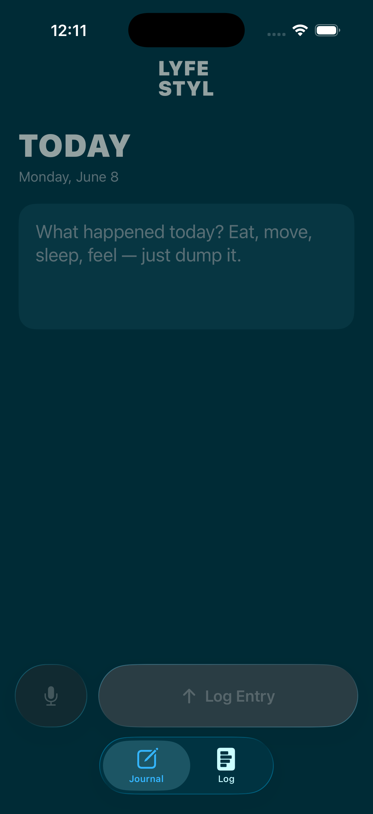
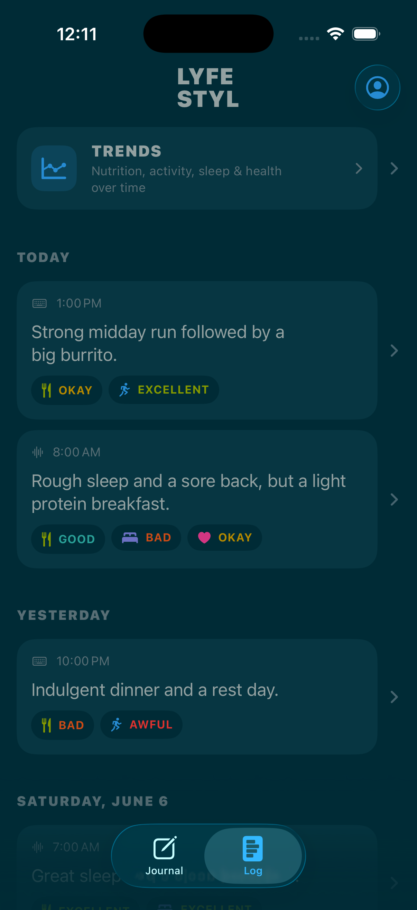
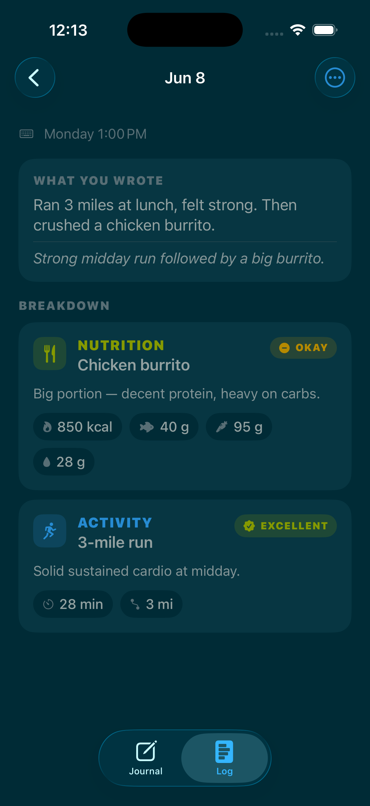
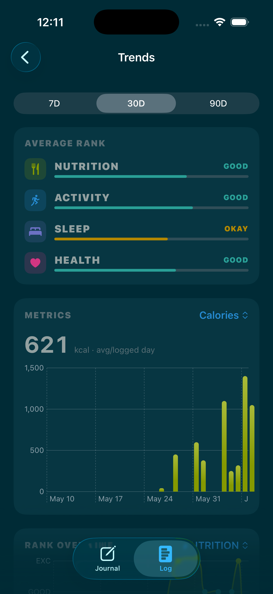

# LYFESTYL

A native iOS 26 health-journaling app. Dump a vague thought — typed or spoken —
and Apple's **on-device Foundation Models** break it into structured, trackable
health data across **Nutrition, Activity, Sleep, and Health**, each with tangible
estimates and a 5-point rank. Fully offline AI, no API keys, no cost, private by
design. Your structured history syncs to your own Supabase account so you can
watch the trends build.

```
LYFE
STYL
```

---

## Screens

| Onboarding | Journal | Log |
| --- | --- | --- |
|  |  |  |

| Entry breakdown | Trends |
| --- | --- |
|  |  |

---

## What it does

- **Journal** — open the app and start typing immediately, or tap the glass mic
  button and talk like a voice memo. Multiple frictionless entries per day,
  auto-stamped to today. Voice is transcribed **on-device** with
  `SpeechAnalyzer` / `SpeechTranscriber`.
- **The pipeline** — every entry runs through Apple's on-device
  **Foundation Models** with **Guided Generation** (`@Generable` / `@Guide`), so
  the model returns typed Swift structs (no JSON parsing). It breaks the entry
  into the categories it actually touches, estimates calories/macros/minutes/
  distance/sleep, and assigns each a rank: `EXCELLENT · GOOD · OKAY · BAD · AWFUL`.
- **Log** — a clean, Apple-Health-style history of every entry's breakdown, with
  search, and **Trends** over time (Swift Charts).

Nothing about the analysis leaves the device. **Supabase is the only external
service** (storage + Sign in with Apple).

---

## Requirements

- **Xcode 26+** and the **iOS 26 SDK**.
- An iPhone (or simulator) on **iOS 26**. The AI breakdown requires a device with
  **Apple Intelligence** enabled; without it the app still saves entries and
  re-analyzes automatically once the model is available (it degrades gracefully).
- A free **Supabase** project.

---

## Setup

### 1. Add your Supabase keys

```bash
cp Secrets.example.plist LYFESTYLE/Secrets.plist
```

Open `LYFESTYLE/Secrets.plist` and paste:

| Key | Value |
| --- | --- |
| `SUPABASE_URL` | your project URL, e.g. `https://YOUR-REF.supabase.co` |
| `SUPABASE_PUBLISHABLE_KEY` | your **publishable** key (starts with `sb_publishable_`) |

Find both in the Supabase dashboard → **Project Settings → API**.

- `LYFESTYLE/Secrets.plist` is **gitignored** — your keys never get committed.
- Use the **publishable** key (client-safe). **Never** put the secret key
  (`sb_secret_…`) in the app — it bypasses Row Level Security. The app doesn't use
  it.
- If the file is missing or still has placeholders, the app shows a clear "Almost
  there" setup screen instead of crashing.
- **The on-device AI needs no key.**

### 2. Create the database schema

In the Supabase dashboard → **SQL Editor → New query**, paste the entire contents
of [`supabase/schema.sql`](supabase/schema.sql) and **Run**. It is idempotent and
creates the `profiles`, `entries`, and `insights` tables, indexes, and Row Level
Security policies so each user only ever sees their own data. (The full SQL is also
reproduced at the bottom of this README.)

### 3. Configure Sign in with Apple

This wires native Sign in with Apple to Supabase Auth.

1. In the **Supabase dashboard → Authentication → Providers → Apple**, enable the
   provider. For a native iOS app you set the **Client IDs** to your app's bundle
   identifier (`Moments.LYFESTYLE`, or whatever you change it to). See Supabase's
   [Apple login guide](https://supabase.com/docs/guides/auth/social-login/auth-apple).
2. In Xcode the **Sign in with Apple** capability is already declared
   (`LYFESTYLE/LYFESTYLE.entitlements`). For a real device build, make sure your
   Apple Developer team has the capability enabled for the App ID. The Simulator
   runs without extra provisioning.

### 4. Build & run

Open `LYFESTYLE.xcodeproj` in Xcode and run on an iOS 26 simulator or device.
Swift Package Manager will resolve the Supabase SDK automatically (or run
`xcodebuild -resolvePackageDependencies -project LYFESTYLE.xcodeproj`).

---

## Architecture

```
LYFESTYLE/
├── DesignSystem/      Solarized palette, type helpers, logo, Rank/Category, shared components
├── Models/            JournalEntry, Insight, MetricKey, Trends + @Generable EntryBreakdown
├── Services/          InsightEngine (Foundation Models), SpeechService (on-device voice),
│                      SupabaseService (CRUD), AuthManager (Sign in with Apple),
│                      LocalStore (offline cache), JournalStore (pipeline orchestrator)
└── Features/          Root · Auth · Journal · Log · Trends · Settings
```

- **On-device AI** — `InsightEngine` checks `SystemLanguageModel.default.availability`
  and runs each entry through a focused `LanguageModelSession` with greedy sampling
  (deterministic, so trends stay comparable). Output is the typed `EntryBreakdown`.
- **Offline-safe** — entries are saved locally the instant they're created and
  never lost. The pipeline (save → push raw → run model → sync insights) retries on
  foreground, on reconnect, and when the model becomes available. Supabase stays
  authoritative; a file-based cache powers instant, offline rendering.
- **Native everything** — `NavigationStack`, `TabView`, `List` + `.searchable` +
  `.swipeActions` + `.refreshable`, `SignInWithAppleButton`, Swift Charts, and
  Liquid Glass (`.glassEffect` / `.glass` / `.glassProminent`) on chrome only.

See [`DECISIONS.md`](DECISIONS.md) for the rationale behind the schema, the scoring
system, and the architecture forks.

### Privacy

The microphone and speech transcription are used **only** while you record, and
transcription happens **entirely on-device**. The AI breakdown is on-device too.
Only the resulting raw text + structured breakdown sync to your private Supabase
account.

---

## Supabase schema (SQL)

> Same as [`supabase/schema.sql`](supabase/schema.sql) — paste into the SQL Editor.

```sql
-- gen_random_uuid() lives in pgcrypto (enabled by default on Supabase).
create extension if not exists pgcrypto;

create table if not exists public.profiles (
    id           uuid primary key references auth.users (id) on delete cascade,
    display_name text,
    created_at   timestamptz not null default now()
);

create table if not exists public.entries (
    id              uuid primary key default gen_random_uuid(),
    user_id         uuid not null references auth.users (id) on delete cascade,
    raw_text        text not null,
    source          text not null default 'text'  check (source in ('text','voice')),
    status          text not null default 'pending'
                        check (status in ('pending','processing','processed','failed')),
    schema_version  int  not null default 1,
    overall_summary text,
    created_at      timestamptz not null default now(),
    entry_date      date not null default (now() at time zone 'utc')::date
);

create table if not exists public.insights (
    id             uuid primary key default gen_random_uuid(),
    entry_id       uuid not null references public.entries (id) on delete cascade,
    user_id        uuid not null references auth.users (id) on delete cascade,
    category       text not null check (category in ('NUTRITION','ACTIVITY','SLEEP','HEALTH')),
    rank           text not null check (rank in ('EXCELLENT','GOOD','OKAY','BAD','AWFUL')),
    rank_score     int  not null check (rank_score between 1 and 5),
    title          text,
    detail         text,
    calories       int,
    protein_grams  int,
    carbs_grams    int,
    fat_grams      int,
    water_ounces   int,
    active_minutes int,
    distance_miles double precision,
    sleep_hours    double precision,
    created_at     timestamptz not null default now(),
    entry_date     date not null
);

create index if not exists entries_user_date_idx   on public.entries (user_id, entry_date desc);
create index if not exists entries_user_created_idx on public.entries (user_id, created_at desc);
create index if not exists insights_entry_idx       on public.insights (entry_id);
create index if not exists insights_user_cat_date_idx on public.insights (user_id, category, entry_date);

alter table public.profiles enable row level security;
alter table public.entries  enable row level security;
alter table public.insights enable row level security;

-- profiles
create policy "profiles_select_own" on public.profiles for select using (auth.uid() = id);
create policy "profiles_upsert_own" on public.profiles for insert with check (auth.uid() = id);
create policy "profiles_update_own" on public.profiles for update using (auth.uid() = id) with check (auth.uid() = id);

-- entries
create policy "entries_select_own" on public.entries for select using (auth.uid() = user_id);
create policy "entries_insert_own" on public.entries for insert with check (auth.uid() = user_id);
create policy "entries_update_own" on public.entries for update using (auth.uid() = user_id) with check (auth.uid() = user_id);
create policy "entries_delete_own" on public.entries for delete using (auth.uid() = user_id);

-- insights
create policy "insights_select_own" on public.insights for select using (auth.uid() = user_id);
create policy "insights_insert_own" on public.insights for insert with check (auth.uid() = user_id);
create policy "insights_update_own" on public.insights for update using (auth.uid() = user_id) with check (auth.uid() = user_id);
create policy "insights_delete_own" on public.insights for delete using (auth.uid() = user_id);
```

> The committed file also adds a `handle_new_user` trigger that auto-creates a
> profile row on sign-up. Run `supabase/schema.sql` to get everything.

---

## Tech

Swift 6 · SwiftUI · `@Observable` · Foundation Models · Speech (`SpeechAnalyzer`)
· AVFoundation · AuthenticationServices · Swift Charts · Liquid Glass ·
[supabase-swift](https://github.com/supabase/supabase-swift) 2.46.
