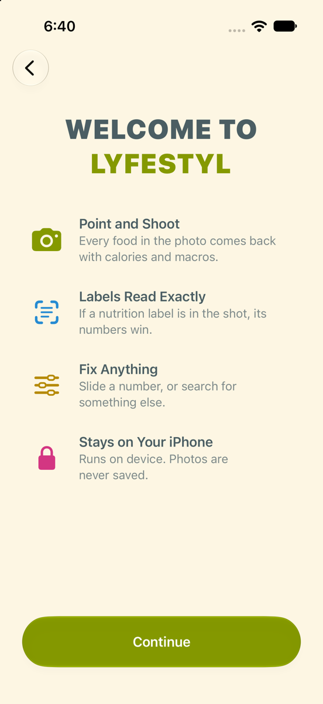
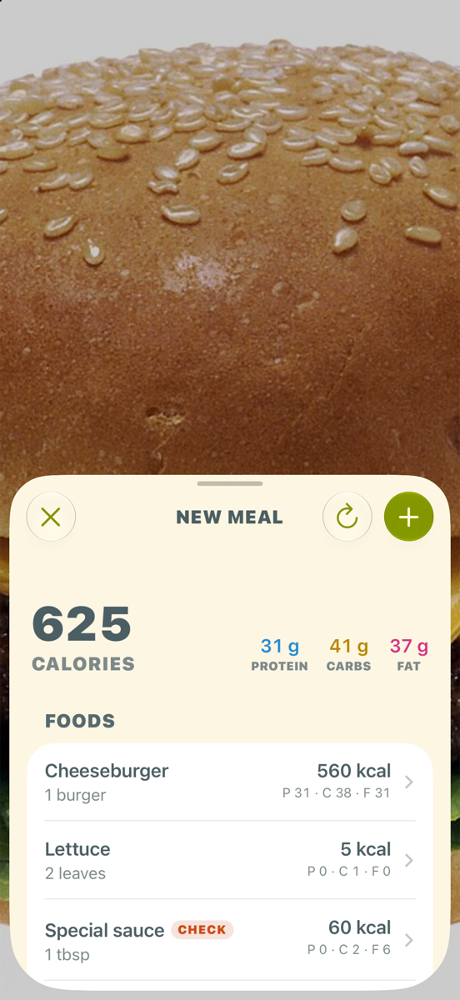
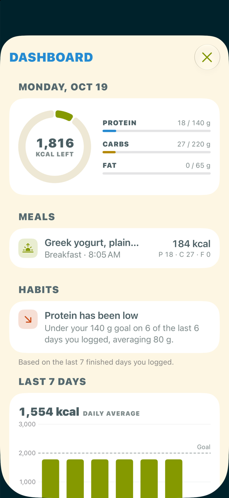

# LYFESTYL

A free, native iOS calorie tracker that runs entirely on your iPhone. Point the camera at a meal and snap. Apple's on-device model itemizes every food with calories, protein, carbs, fat and a confidence level. Fix anything with a tap, then log it. Photos are never stored.

<p>
  
  
  
</p>

<sub>Simulator screenshots with sample meals. Product photo from Open Food Facts, CC BY-SA.</sub>

## How it works

**One screen: the camera.** Shutter bottom center, account and settings top left, dashboard top right, today's calories left at the top. The photo library button (bottom left) and search (bottom right) cover meals you can't photograph right now. The volume buttons and Camera Control also work as the shutter.

**Snap.** The shutter doesn't run a photo capture. It grabs the next frame from the live video feed (4K where available), the way Snapchat does, so it's instant. The frame freezes on screen and develops like a print (soft and colorless, drifting closer, then snapping into focus when the result lands), and the drawer rises at once: placeholders shimmer, each food resolves in as the model names it, and its calories count up as they're written.

**Labels are read, not guessed.** Before the model runs, Vision reads any printed text in the frame on device (about 0.2 s). That text goes into the prompt so the model can identify the exact product. The identity stays behind the scenes (it decides which food a label belongs to); the drawer shows a plain name like "Protein Shake". Any nutrition numbers on the label, from a Nutrition Facts panel ("Protein 30g") or a front-of-pack claim ("30g HIGH QUALITY PROTEIN", "150 CALORIES"), replace the model's estimate for that product outright and mark it high confidence (`LabelFacts`). Numbers are only attached when it's clear which food the label belongs to: the one packaged item, or the only item. Unlabeled food is estimated from typical USDA values.

**Confident result.** The drawer shows the total and each food with its numbers, nothing else. The time is recorded silently. Tap a food to change its name, servings or numbers, pick one of the model's other guesses, or search for something else. Swipe to remove, Add Food to add. X dismisses, + logs, the retry button reads the photo again (sampled, so it can come out differently).

**Unsure result.** If the model can't commit to anything, or sees no food, the drawer opens on search instead: its guesses first, then your recent foods. Typing searches foods you've logged before, a bundled table of about 120 common foods, and offers an on-device estimate of whatever you typed ("two eggs and toast" works) or manual entry. Individual low-confidence foods in a confident scan are marked CHECK and lead to the same search.

**No photos kept.** Frames are capped at 2560 px in memory and released the moment you log or dismiss. Nothing is written to disk or the photo library. A logged meal stores only its foods, as one binary blob of well under 100 bytes per food.

**Dashboard.** Laid out like the Health app's Summary: a Today card with calories, protein, carbs and fat in colored columns and concentric rings toward your goals; today's meals; a card per nutrient with its last seven days (tap for a full chart with W, M, 6M and Y ranges, a daily average you can scrub, and the goal as a dashed line); highlight cards for your habits with average versus goal; and the history by day. Tap any meal to edit it in the same drawer.

**Habits** are plain arithmetic over the last 7 finished days you logged, with no model involved, so every flag has a checkable reason: low protein (under 80% of goal on most logged days), high carbs (over 115%), high fat (over 120%), calories over (110%) or well under (70%, which usually means meals are missing). Fewer than 3 logged days shows no flags.

**Account and settings.** Your profile photo and name, daily goals with a calculator (Mifflin-St Jeor, can fill height, weight, age and sex from Apple Health), saving meals to Apple Health, the on-device model's status, CSV export, and delete all.

## Apple frameworks, nothing else

| Need | Framework |
| --- | --- |
| Camera | AVFoundation (`AVCaptureVideoDataOutput`, virtual multi-camera for close-up auto switching) |
| Reading food | FoundationModels (`Attachment`, `@Generable`, `streamResponse`), iOS 27 |
| Reading labels | Vision (`RecognizeTextRequest`) |
| Meal storage and sync | SwiftData mirrored to the CloudKit private database |
| Goals sync | iCloud key-value storage (`NSUbiquitousKeyValueStore`) |
| Health | HealthKit (write dietary energy, protein, carbs, fat; read body metrics) |
| UI | SwiftUI, Liquid Glass chrome, Swift Charts, PhotosUI, `ShareLink` |

No accounts, no servers, no API keys, no third-party packages. The iCloud account signed in on the device owns the data.

## Requirements

- Xcode 27, iOS 27 SDK. The deployment target is iOS 27 because image input to Foundation Models (`Attachment`) is iOS 27 only.
- An iPhone with Apple Intelligence turned on for photo logging. Without it the app still works through search, the common foods table and manual entry; with a text-only model, typed estimates still work.
- The iOS 27 Simulator runs the UI, but generation needs a host Mac on macOS 27. On macOS 26 the simulator reports the model available and then fails each request (`ModelManagerError 1001`), which the app shows as "Couldn't read that" with Try Again and Search.

## Setup

Signing is automatic under team `4Q768JXR89`, bundle ID `Moments.LYFESTYLE`. The App ID is registered with every capability the app uses (in `LYFESTYLE.entitlements`): iCloud with CloudKit (container `iCloud.Moments.LYFESTYLE`) and key-value storage, Push Notifications (CloudKit syncs over silent pushes), and HealthKit. Background Modes > Remote notifications is set in the build settings.

1. Open `LYFESTYLE.xcodeproj` and run on a device. If you change the team, bundle ID or container, build once with Xcode (or `xcodebuild -allowProvisioningUpdates`) so the new App ID and container are registered, and update `LYFESTYLEApp.cloudContainerID` to match the container.
2. The first launch in the Development environment creates the CloudKit schema automatically.
3. Before shipping, deploy the schema to Production in the CloudKit Console (Schema > Deploy Schema Changes).

The app needs no secrets, API keys or config files.

## CloudKit record schema

SwiftData's CloudKit mirroring writes one record per meal to the private database, default zone `com.apple.coredata.cloudkit.zone`:

**Record type `CD_MealEntry`**

| Field | CloudKit type | Swift | Notes |
| --- | --- | --- | --- |
| `CD_id` | String | `UUID` | Stable across devices; prefix of the Apple Health sync identifiers |
| `CD_loggedAt` | Date/Time | `Date` | When the meal was logged, recorded automatically |
| `CD_itemsData` | Bytes | `Data` | `[FoodItem]` as a binary property list |
| `CD_entityName` | String | | Added by SwiftData |

Each food inside `CD_itemsData` uses one-letter keys to stay small:

| Key | Meaning |
| --- | --- |
| `n` | name |
| `p` | portion, like "1 cup" (omitted when empty) |
| `s` | servings multiplier (omitted when 1) |
| `k`, `r`, `c`, `f` | kcal, protein g, carbs g, fat g for one portion, rounded |

**iCloud key-value storage**: `goals.v1` (daily goals) and `bodyProfile.v1` (calculator inputs), both JSON; `profile.name` (string) and `profile.photo` (the chosen profile photo, a 256 px square JPEG of about 25 KB, the only image the app keeps).

**Apple Health**: each meal writes up to four quantity samples (dietary energy, protein, carbohydrates, total fat) with `HKMetadataKeyFoodType` set to the meal title and `HKMetadataKeySyncIdentifier` set to `<meal id>.<macro>`, so edits replace and deletes remove them.

## Project layout

```
LYFESTYLE/
  App/            entry point, SwiftData + CloudKit container
  DesignSystem/   Solarized palette, type, logo, components, Macro tokens, formatting
  Models/         FoodItem/Nutrition, MealEntry (@Model), Goals, FoodScan (@Generable), CommonFoods
  Services/       FoodAnalyzer, CameraController, HealthService, GoalStore, MealLog, HabitEngine, MealExport
  Features/
    Camera/       the main screen, preview, shutter
    Review/       the drawer, item editor, food search
    Dashboard/    totals, habits, chart, history
    Settings/     account, goals, goal calculator
    Onboarding/
Verification/     logic checks compiled against the app's own sources
```

## Verification

```
Verification/run.sh
```

Compiles the pure-logic sources (storage encoding, nutrition math, goal calculator, habit rules, label parsing, CSV export, food search and the bundled table's internal consistency) with a set of hand-worked checks, and runs them on the Mac. It needs no simulator.
